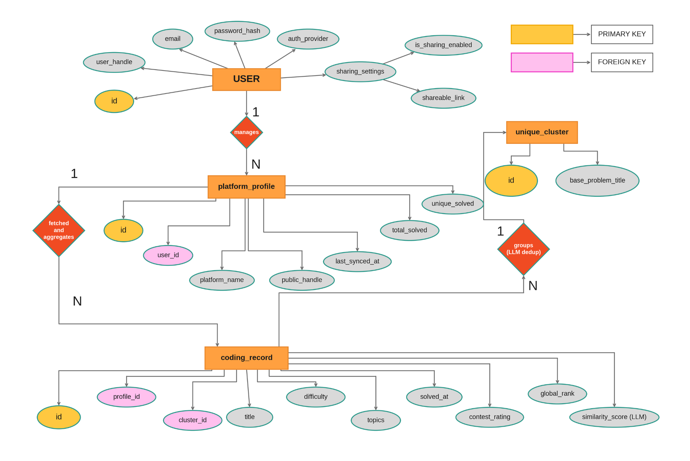
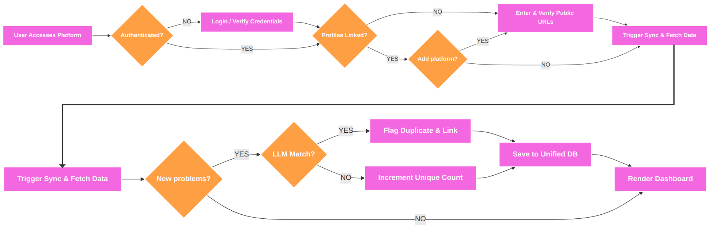
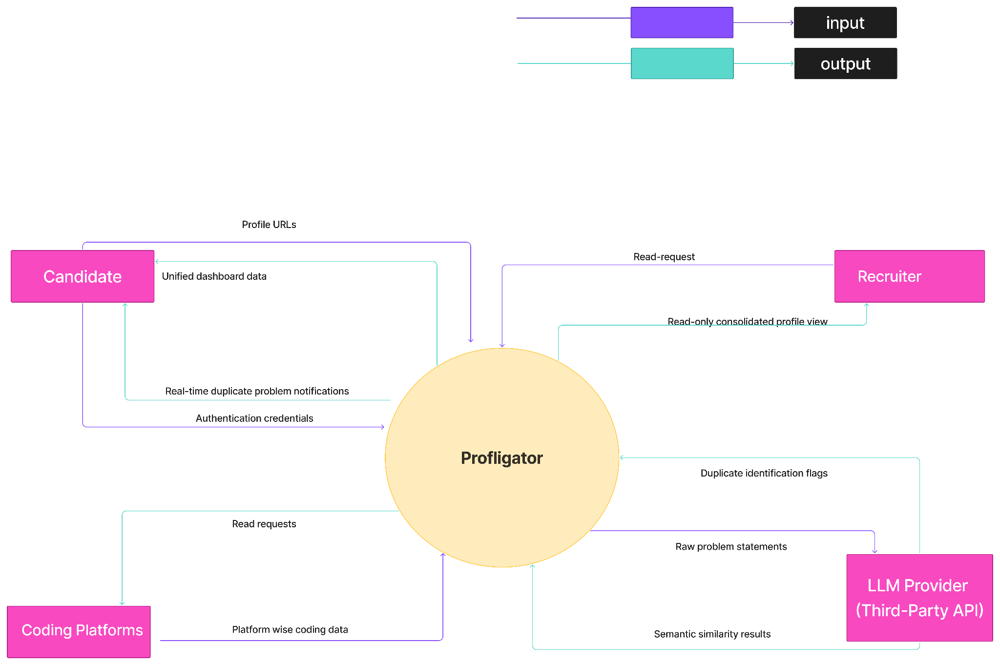
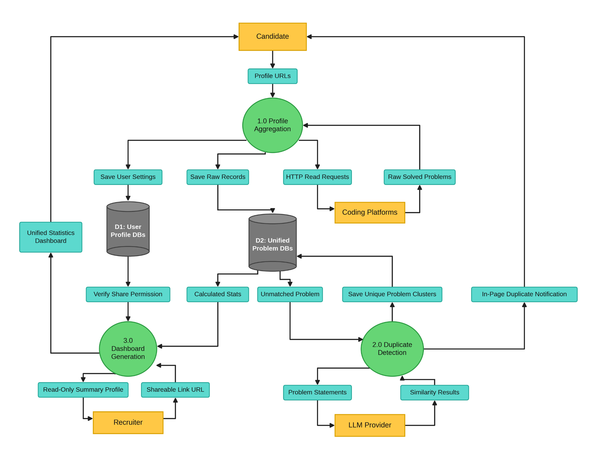

# Backend implementation from the Group 5 report

The source is [`Group - 5 .docx`](../Group%20-%205%20.docx). Its software requirements and Figures 11.2, 11.3, 11.4, and 11.11 define the backend behavior. The report introduces CodeFusion and later names the implemented product Profligator. The existing application name is retained.

## What the diagrams specify

The report also includes Agile delivery guidance, interface mock-ups, function-point analysis, and COCOMO effort estimates. The mock-ups define the backend's user interactions; the estimation sections describe project size and effort rather than additional database entities or API features.

| Diagram | Meaning | Backend implementation |
| --- | --- | --- |
| ER, Figure 11.11 | A user manages many platform profiles; each profile contains many coding records; a unique cluster groups many problem records. Sharing settings belong to the user. | SQLAlchemy models and migration `20261001_0004`; candidate ownership; derived platform totals; problems and contests share the `coding_records` table using `kind` as their discriminator. |
| CFD, Figure 11.2 | Authenticate, link profiles, fetch data, evaluate new problems, group duplicates or retain distinct problems, then serve the dashboard. | Authentication dependencies, connector registry, `execute_sync`, matching service, dashboard repository. |
| DFD level 0, Figure 11.3 | Candidates provide credentials and profile URLs; coding platforms return public records; the LLM supplies matching decisions; recruiters receive a consented read-only view. | Candidate APIs, configurable external adapters, Ollama matching provider, public profile endpoint. |
| DFD level 1, Figure 11.4 | Separate profile aggregation, duplicate detection, and dashboard generation, with user/profile and problem stores. | `connectors/` and `jobs.py`; `matching.py`; `repository.py` and `report_routes.py`. D1 and D2 are logical stores within the same relational database. |









## ER attributes and database names

| Report attribute | Storage or calculation |
| --- | --- |
| `USER.id`, `email`, `user_handle`, `password_hash`, `auth_provider` | `users.id`, `email`, `handle`, `password_hash`, `auth_provider`. Passwords use the existing Argon2 implementation. |
| Composite `sharing_settings` | `users.is_sharing_enabled` and nullable `share_token`; the configured web origin and token form `shareable_link`. |
| `platform_profile.user_id`, `platform_name`, `public_handle`, `last_synced_at` | Foreign key to `users`, `platform`, `public_handle`, `last_successful_sync`. |
| `platform_profile.total_solved`, `unique_solved` | Calculated from solved problem records and their confirmed clusters. Provider totals remain separately available as `source_total_solved`. |
| `coding_record.profile_id`, `cluster_id` | `platform_profile_id` and nullable FK to `unique_clusters`. Contests do not enter problem clusters. |
| `title`, `difficulty`, `topics`, `solved_at` | `title`, `difficulty`, JSON `topics`, and `occurred_at`; this timestamp also supports contest dates. |
| `contest_rating`, `global_rank` | Nullable integer fields populated only from supplied contest history. |
| `similarity_score (LLM)` | Internal decision confidence, never shown as a calibrated similarity percentage. |
| `unique_cluster.id`, `base_problem_title` | `unique_clusters.id`, `base_problem_title`, plus a candidate ownership FK. |

The schema additionally retains source IDs, problem URLs, optional original submission URLs, public problem statements, refresh sessions, sync history, and matching decisions. Candidate-specific clusters prevent private history from becoming visible through another account. `match_decisions` records the provider, model, input checksum, decision, confidence, and explanation.

## Resolving differences within the report

The SRS explicitly defers visible similarity scores and automatic tags, while the ER diagram and extension function-point example mention a score. The implementation stores decision confidence for audit and returns a duplicate flag and a previous-attempt link. No score is exposed by the extension API.

The profile mock-up and function-point tables mention additional platforms. The SRS launch scope takes priority: LeetCode, GeeksforGeeks, and Codeforces are supported. The diagram's inheritance is represented by the existing `kind` discriminator in one coding-record table, rather than adding separate problem and contest tables.

The sharing design says anyone holding an enabled link can view the profile. The public route therefore uses a random capability token and returns only a read-only summary. Recruiter accounts can authenticate but cannot call candidate history, profile management, dashboard, matching, or sharing routes. A handle by itself cannot unlock sharing.

## API

Existing authentication, profile linking/checking/disconnection, sync creation/polling, and dashboard routes remain under `/api/v1`.

| Method | Path | Behavior |
| --- | --- | --- |
| GET | `/sharing` | Candidate's current consent and share link; sharing starts disabled. |
| PUT | `/sharing` | JSON `{"enabled": true}` or `false`; disabling removes the token, and enabling again generates a new token. |
| GET | `/public-profiles/{token}` | Read-only candidate handle and dashboard, available only while the matching token is enabled. Responses prohibit caching. No email, credentials, statements, or session values are returned. |
| GET | `/coding-records?offset=0&limit=100` | Candidate's active source records with provenance and matching state. |
| GET | `/unique-clusters?offset=0&limit=100` | Candidate's active solved records grouped by confirmed cluster, retaining each source URL. |
| POST | `/extension/check` | Check the opened problem against the authenticated candidate's solved history. Input is bounded and its HTTPS host must match the platform. No supplied URL is fetched. |

Example extension request:

```json
{
  "platform": "codeforces",
  "source_id": "100-A",
  "title": "Example problem",
  "canonical_url": "https://codeforces.com/problemset/problem/100/A",
  "statement": "Full public problem statement, including constraints and expected output.",
  "topics": ["Array"]
}
```

A confirmed response includes `previous_attempt` with the source platform, ID, problem URL, optional submission URL, and solving timestamp. If the provider never exposes a submission URL, it remains null and the problem URL remains available. Missing statements, a disabled model, a timeout, and no confirmed match produce distinct states. No match does not guarantee that the problem is new.

The dashboard adds `unique_problems_solved`, `matched_records`, `unmatched_records`, per-platform source totals and coverage, latest sync errors, rating/rank, and imported contests. `provisional_unique_problems` remains a compatibility alias for the cluster-derived count. All totals describe imported solved records; provider totals are not substituted for an unavailable detailed history.

## Matching behavior and configuration

Matching uses exact statement comparison first, preserving case, numbers and operators. Shared titles or topics alone never collapse records. A replaceable `MatchProvider` protocol supplies semantic decisions. The Ollama adapter uses its documented [chat API](https://docs.ollama.com/api/chat); the Groq adapter uses hosted chat completions with strict structured JSON. Both validate the same comparison schema, use non-streaming responses and temperature zero.

Configure an installed model explicitly:

```dotenv
PROFLIGATOR_MATCHING_BACKEND=ollama
PROFLIGATOR_MATCHING_BASE_URL=http://localhost:11434
PROFLIGATOR_MATCHING_MODEL=<installed-model-name>
```

For hosted inference, set `PROFLIGATOR_MATCHING_BACKEND=groq`, `PROFLIGATOR_MATCHING_MODEL=openai/gpt-oss-120b` and a server-only `PROFLIGATOR_GROQ_API_KEY`. Groq is wired into the same synchronization, history-import and extension-check matching service. [Groq setup and verification](groq-matching.md) records the current development checks and rate-limit behavior.

The default backend is `disabled`: exact statement matching still runs, and records without confirmed equivalence remain distinct. The default semantic confidence threshold is 0.95; it is a configurable engineering guard, not an experimentally established false-positive guarantee. Candidate retrieval now normalizes source topic aliases, uses multiple algorithm/domain labels, filters incompatible known buckets and DP patterns, then ranks shared informative words with frequency weights. Incremental inverted indexes and cached local features supply shortlists; no model request is needed for classification. See [candidate retrieval](groq-matching.md#candidate-retrieval).

The default shortlist has at most eight candidates (distinct clusters during saved-history matching). Unknown classifications use at most two keyword-related fallback candidates within that total. Known DP patterns include LCS, LIS, edit distance, knapsack variants, subset sum, coin change, grid paths, interval, tree, digit, bitmask and linear recurrence/nonadjacent selection. Generic tags do not by themselves generate comparisons. Exact identity/statements bypass retrieval restrictions and require no model call. Missing/incorrect tags, heuristic classification and lexical thresholds can still miss paraphrases; this is not vector retrieval or a validated classification model. Provider topics and dashboard topic counts are unchanged.

Every member of a proposed cluster is compared directly to the incoming problem, avoiding unsupported transitive chains. Repeated comparisons reuse persisted decisions for identical inputs and model. Sync matching has a 60-second budget and at most 64 model comparisons by default; extension checks have a 10-second overall budget. Model errors retain imported history and expose matching availability. Concurrent source changes invalidate the in-flight clustering result.

Evaluate multiple candidate models before selecting one:

```bash
PYTHONPATH=apps/api/src apps/api/.venv/bin/python -m profligator_api.evaluate_matching \
  --dataset apps/api/tests/fixtures/matching_pairs.jsonl \
  --models exact <model-a> <model-b> \
  --output /tmp/profligator-model-evaluation.json
```

The command records precision, recall, false positives/negatives, provider errors and latency for each model. Costs are explicitly unavailable until billing or local compute costs are supplied. The included six synthetic pairs are a smoke dataset, not the agreed launch validation set. No production model is selected and no semantic accuracy claim is made from this dataset.

Pass `--provider groq` to evaluate hosted models. Provider failures are recorded with an unknown prediction and excluded from classification metrics; the command exits with status 2 if any comparison is unavailable. On 6 October, Groq `openai/gpt-oss-120b` correctly classified all six smoke pairs and passed isolated live clustering/dashboard/extension checks. It is the configured local-development provider, not a validated production model.

## Connectors and periodic sync

Codeforces uses its official public API. In addition to solved problems, it imports rated contest history through [`user.rating`](https://codeforces.com/apiHelp/methods#user.rating), profile ratings/rank, and submission URLs supplied by accepted submissions. Repeated submissions on a fetched problem retain the earliest available accepted timestamp and link. Public availability never marks an account as ownership verified.

LeetCode and GeeksforGeeks now default to the source-specific public collectors documented in the [collector guide](public-collectors.md). Their available public statements feed the matching pipeline; source history and statement coverage remain explicit. Fixture mode remains available per platform. Set `PROFLIGATOR_AGGREGATION_SERVICE_URL` to an operator-controlled service to override both with the normalized adapter. This does not install, deploy or audit a third-party service. The adapter expects:

| Request | Response |
| --- | --- |
| `GET /v1/{platform}/profiles/{handle}` | A `ProfileSnapshot`: `profile`, `fetched_at`, nullable `source_total_solved`, `rating`, `rank`, and nullable `history_complete`. |
| `GET /v1/{platform}/profiles/{handle}/records?kind=problem&cursor=...` | A `ConnectorPage`: up to 1000 normalized problem records and nullable `next_cursor`. |
| Same route with `kind=contest` | A page of normalized contest records; an empty page is valid when no history is exposed. |

Each record supplies `platform`, `source_id`, `kind`, `status`, `title`, HTTPS `canonical_url`, and `source_payload_checksum`; optional fields include difficulty, topics, timestamp, public statement, submission URL, contest rating and rank. Identity, platform, kind, and response schemas are validated. A partial recent history must set `history_complete=false`; unknown coverage remains null. The service URL is deployment configuration, never candidate input.

Run one scheduler process per deployment alongside the API and, in RQ mode, the worker:

```bash
npm run api:scheduler
# Or with the existing virtual environment:
apps/api/.venv/bin/python scripts/run_scheduler.py
# One polling pass:
apps/api/.venv/bin/python scripts/run_scheduler.py --once
```

The default sync interval is six hours. The scheduler skips disconnected profiles and recent/pending/running syncs, limits retries through the existing job pipeline, and marks abandoned worker runs failed. It must not be horizontally replicated without a distributed scheduling lock. The API does not start periodic scheduling implicitly.

## Database migration and verification

For a migration-managed database:

```bash
apps/api/.venv/bin/alembic -c apps/api/alembic.ini upgrade head
```

The new migration preserves existing records, defaults existing users to candidate accounts with sharing disabled, creates singleton clusters for historical solved records, and adds the new foreign keys and contest/matching fields. The current local database was backed up, verified against the previous schema, stamped at its matching legacy revision, then upgraded. Its existing row counts were preserved. For another legacy database created by `create_all` without Alembic history, verify that its schema actually matches revision `20260925_0003` before stamping it; an arbitrary stamp is not a migration.

```bash
apps/api/.venv/bin/python -m pytest -q apps/api/tests
npm run build
```

Tests cover consent and link revocation, roles and history isolation, exact/semantic decisions, confidence rejection, provider errors, decision caching, unsafe URLs, periodic sync, connector schemas, contest parsing, evaluation metrics, and migration upgrade/downgrade preservation.

Remaining external acceptance work: validate deployed collector operation and broader history/statement coverage; evaluate real LLM models against an agreed dataset and latency/cost targets; test PostgreSQL and Redis/RQ in a deployed environment; finish normal live-platform and cross-browser extension acceptance. The [installed extension](browser-extension.md) was added on 3 October with scoped, revocable device sessions and migration `20261003_0009`; Chromium controlled-page acceptance and Firefox connection/popup acceptance pass.
